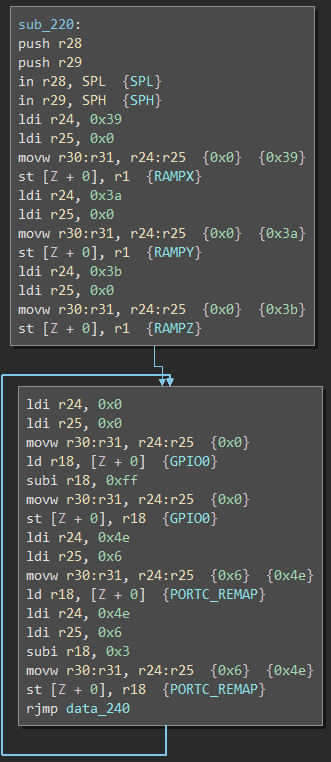
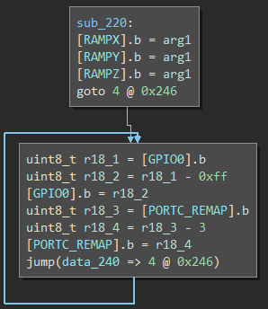

# Binary Ninja AVR plugin
This plugin adds support for the AVR architecture to binaryninja. All instructions
should be implemented, lifting is mostly implemented.

## Installation
Run this command in your BN plugins folder:
`git clone https://github.com/fluxchief/binaryninja_avr.git`

Another option is to download this repository as a ZIP file and
extract it in your BN plugins folder.

## How is it different than [binja_avr](https://github.com/cah011/binja-avr)?
1) This project aims for a better support of different chips. It currently has

 - ATMega16
 - ATMega168 / ATMega328
 - ATTiny48
 - ATTiny88
 - ATXMega128A4u

support and can be easily extended.

2) This plugin also lifts the AVR instructions. While I at first intended to add
lifting to `binja-avr`, the changes would have been to large so that I decided
to write this plugin from scratch instead.

3) Interrupt vectors are defined automatically.

4) Xrefs on memory.

5) ELF files are supported: the loader reads `PT_LOAD` program headers and
   only maps the bytes that are actually resident in flash, instead of
   treating the whole ELF file (including symbol tables/debug info) as the
   flash image.

## Loading a file / selecting the chip
Because AVR binaries have no magic bytes to auto-detect, this plugin never
auto-selects itself for a file. To load one:

1) In Binary Ninja, use **File -> Open with Options...** (not a plain
   double-click/drag-and-drop, which will open the file with the default
   view instead).
2) Pick **AVR** as the BinaryViewType.
3) Under the options tree, find **AVR chip** (`avr.chip`) and select the
   target chip from the dropdown before loading.

If you don't see the `avr.chip` setting in the options tree, double check
you're using "Open with Options" rather than a regular open, and that your
Binary Ninja version is recent enough to support this plugin (see
`plugin.json`'s `minimumbinaryninjaversion`).

## I found a bug!
"Awesome"! Please create a ticket and don't forget to upload your sample there
as well (if possible).

## Known issues/limitations

 - RAMPX/RAMPY/RAMPZ not used - This isn't lifted as much as it could be and
   decreases the readability of the code, so I disabled the use of these
   registers.
 - Skip instruction followed by a 4 bytes instruction potentially breaks.
   This is a limitation of BN. BN only sends the raw bytes until the end of
   the basic block to the plugin, so there is no way we can figure out whether
   the length of the next instruction is 2 or 4 bytes. It seems to be 2 bytes
   most of the cases, so I hardcoded it to 2.
 - Flags aren't used properly (in lifting).

## License

[MIT](LICENSE)
